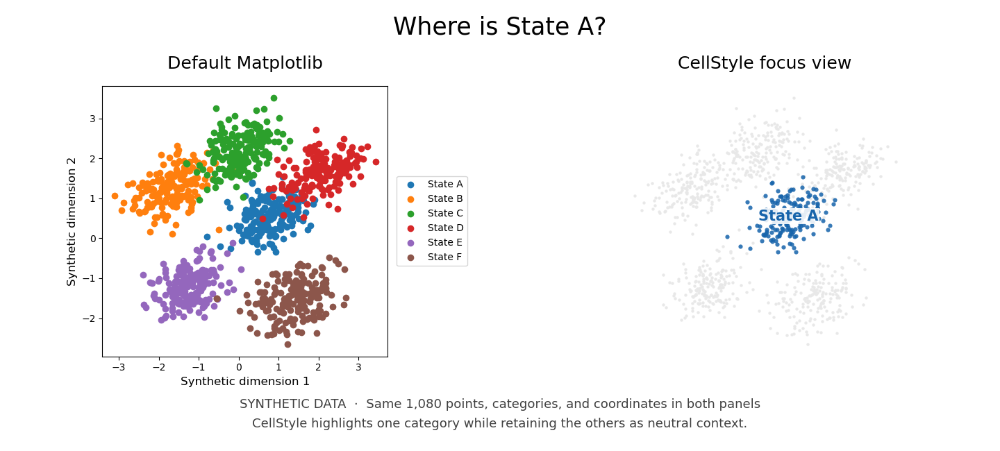
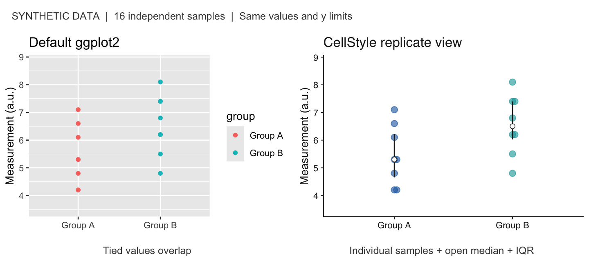

# CellStyle

One-call scientific plotting for Python and R. CellStyle gives common scatter and replicate plots readable defaults, and styles native Matplotlib, Scanpy, ggplot2 and individual Seurat plots without changing their data or scientific encodings. APIs and defaults are provisional before 1.0.

## Install v0.3.0

Python 3.10 or later:

```bash
python -m pip install "git+https://github.com/nbatada/cellstyle.git@v0.3.0"
```

R 4.1 or later:

```r
remotes::install_github("nbatada/cellstyle", ref = "v0.3.0",
                        subdir = "r/cellstyle", upgrade = "never")
```

The [v0.3.0 GitHub release](https://github.com/nbatada/cellstyle/releases/tag/v0.3.0) also provides a Python wheel, Python source distribution, and R source package. Optional integrations and system requirements are in the [R guide](docs/R_BACKEND.md) and [panel export guide](docs/panel-export.md). CellStyle is not claimed to be on PyPI or CRAN.

## Make a plot

```python
import cellstyle as cs

ax = cs.quantitative_scatter(df["Before score (a.u.)"],
                             df["After score (a.u.)"], output="scatter.pdf")
ax = cs.replicate_distribution(df, "Group", "Signal (a.u.)")
```

```r
library(cellstyle)
p <- quantitative_scatter(df, "Before score (a.u.)",
                          "After score (a.u.)", output = "scatter.pdf")
p <- replicate_distribution(df, "Group", "Signal (a.u.)")
```

Each helper returns a native plotting object. `output` is optional; supported formats are PDF, SVG, and PNG. Saving refuses an existing file or missing parent directory. Rows in a replicate plot must already represent the intended observation unit; CellStyle does not determine biological replication or run a statistical test by default. See [one-call usage and limits](docs/one-shot.md).

To style an existing native plot:

```python
ax = cs.style_plot(sns.boxplot(data=df, x="Group", y="Signal (a.u.)"))
ax = cs.style_plot(sc.pl.umap(adata, color="cell_type", show=False))
```

```r
p <- style_plot(ggplot2::ggplot(df, ggplot2::aes(Group, Signal)) +
                ggplot2::geom_boxplot())
p <- style_plot(Seurat::DimPlot(object, combine = FALSE)[[1]])
```

Native styling keeps Python multi-axes geometry and existing color/data encodings. R accepts one ggplot, including an individual Seurat plot; patchwork composites are unsupported. It does not add observations to a boxplot or infer scientific labels.

## See the difference

These examples use synthetic observations and demonstrate plotting behavior, not a biological result.

### Focus on one population (Python)



CellStyle keeps other states visible as context while highlighting one state; coordinates stay fixed. [Reproduce this plot](examples/python_focus_comparison.py).

### Show individual replicates (R)



The beeswarm separates overlapping observations. [Reproduce this plot](examples/r_replicate_comparison.R).

## Optional workflows

- [R guide](docs/R_BACKEND.md): native ggplot themes, identity colors, beeswarms, labels, and supplied comparisons.
- [Scientific labels](docs/semantic-labels.md): opt-in declarations and checks against visible native text; no mandatory JSON.
- [Physical panel export](docs/panel-export.md) and [Inkscape assembly](docs/inkscape-assembly.md): exact slot dimensions with receipts and manual final review.
- [v0.3.0 release notes](docs/RELEASE_NOTES_v0.3.0.md): changes and current boundaries.

The five-color identity palette is provisional; larger category sets need an explicit palette and review. CellStyle does not grant manuscript acceptance, full artifact quality control, or journal compliance. Statistical annotations render results supplied by the analysis; their validity remains the caller's responsibility.

Licensed under the [MIT license](LICENSE). Citation metadata is in [CITATION.cff](CITATION.cff).
