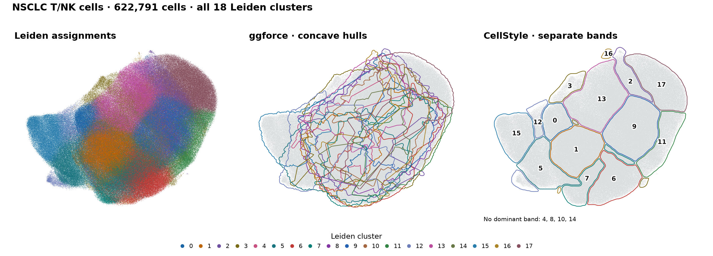
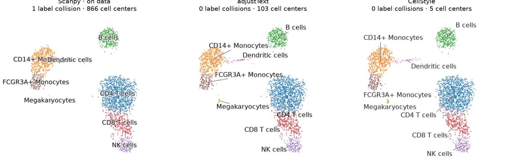
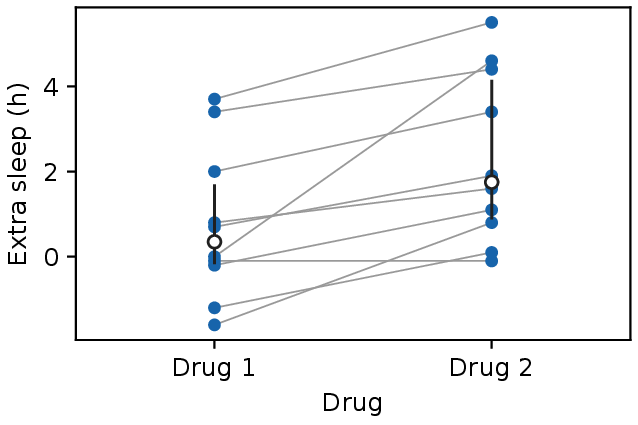
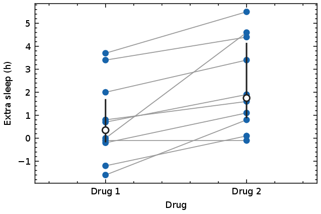
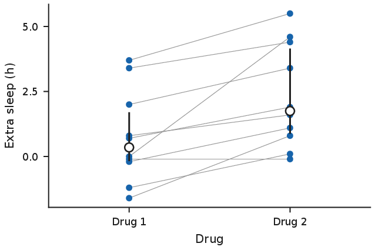

# CellStyle

Label a cell map, outline clusters while colour shows gene expression, and export the same scientific figure for a paper and a PowerPoint slide. CellStyle works with native Matplotlib and ggplot2 plots.



## Install the current Python or R source

Python 3.10 or newer:

```bash
python -m pip install "cellstyle[export] @ git+https://github.com/nbatada/cellstyle.git@main"
```

Use `[scanpy,export]` for the AnnData helpers. In R 4.1 or newer:

```r
install.packages("remotes")  # once
remotes::install_github("nbatada/cellstyle", ref = "main", subdir = "r/cellstyle")
```

Current source version: **0.4.0**. [Tagged releases and downloadable archives](https://github.com/nbatada/cellstyle/releases).

## Keep expression in colour and show a cluster outline

```python
import scanpy as sc
import cellstyle as cs

ax = sc.pl.umap(adata, color="NKG7", show=False)
cs.cluster_outline(ax, adata, groupby="leiden", clusters=["4"])
```

```r
library(ggplot2)
library(cellstyle)
p <- ggplot(cells, aes(UMAP1, UMAP2)) +
  geom_point(aes(colour = NKG7)) + coord_equal()
p + geom_cluster_outline(aes(group = leiden), clusters = "4")
```

Omit `clusters` to outline all groups. The default outlines high-density regions. For adjacent groups, `method="territory"` draws where each group is locally most abundant. Dispersed members can fall outside their own band. In the NSCLC benchmark, 14 of 18 groups had a band and 63.5% of cells lay inside their own. [Two neighboring NSCLC clusters](docs/showcase/nsclc-shared-island.png) · [All Yost BCC T cells](docs/showcase/yost-bcc-all-clusters.png) · [Two neighboring Yost clusters](docs/showcase/yost-bcc-shared-island.png) · [Single-cluster example](docs/showcase/python-one-and-all.png).

## Place labels on a dense embedding

For a simple map, Scanpy already offers `legend_loc="on data"`. CellStyle chooses label positions at the figure's render size, and can use scientist-supplied short names where they improve the fit.



```python
ax = sc.pl.umap(adata, color="cell_type", legend_loc=None, show=False)
xy = adata.obsm["X_umap"]
cs.label_groups(ax, xy[:, 0], xy[:, 1], adata.obs["cell_type"],
                short_labels={"Dendritic cells": "DCs"})
```

In R, add `geom_cell_labels(aes(label = cell_type))` to your plot. The comparison is specific to the displayed size and dataset.

## Compare observations and save paper and slide copies

All three panels show the same ten participants with the same paired measurements, median and interquartile range. The native Matplotlib and SciencePlots versions use explicit pair matching and summary code. CellStyle takes the participant ID in the plotting call.

| Matplotlib | Matplotlib + SciencePlots | CellStyle |
|---|---|---|
|  |  |  |

```python
import pandas as pd
import cellstyle as cs

data = pd.read_csv("examples/sleep.csv")  # from this repository
ax = cs.pl.paired(data, pair="Participant", x="Drug", y="Extra sleep (h)")
cs.save_for_paper_and_slides(ax, "sleep-figure")
```

The output includes a manuscript PDF, a slide-sized SVG and a receipt with lettering size at the intended placement. For this 90 × 60 mm plot, the smallest lettering is 16.9 pt when placed at 217.5 × 145 mm on the slide. R provides `paired_distribution()` and `save_for_paper_and_slides()`. [Example PowerPoint slide](docs/showcase/placement-example.pptx) · [Python and R plot gallery](docs/gallery.md) · [Plot types and calls](docs/plot-types.md) · [Original sleep dataset](https://stat.ethz.ch/R-manual/R-devel/library/datasets/html/sleep.html).

## More workflows

- [Compose a native Scanpy cell map and marker matrix](docs/cell-overview.md).
- [Style an existing plot](docs/one-shot.md) or [use R's themes and scales](docs/R_BACKEND.md).
- [Check saved figures](docs/checked-figures.md), [compare encodings across Python panels](docs/figure-set.md) and [detect changed source files](docs/figure-recipes.md).
- [Export panels at specified physical dimensions](docs/panel-export.md).

MIT licensed. See [LICENSE](LICENSE) and [CITATION.cff](CITATION.cff).
