# Python and R plot gallery

Both columns show the same data. Marker plots use PBMC3k. Other panels use synthetic observations or illustrative intervals.

| Plot | Python | R |
|---|---|---|
| paired | 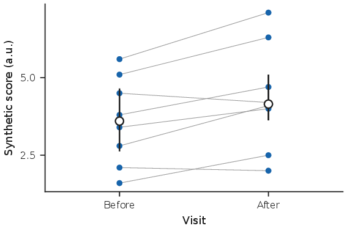 | 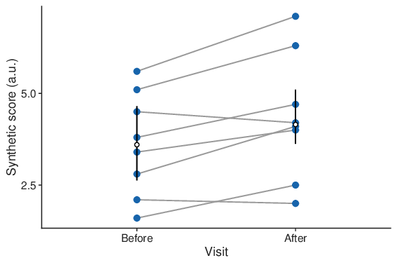 |
| grouped-swarm | 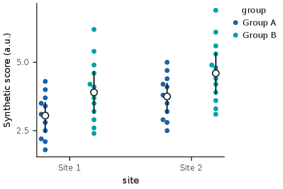 | 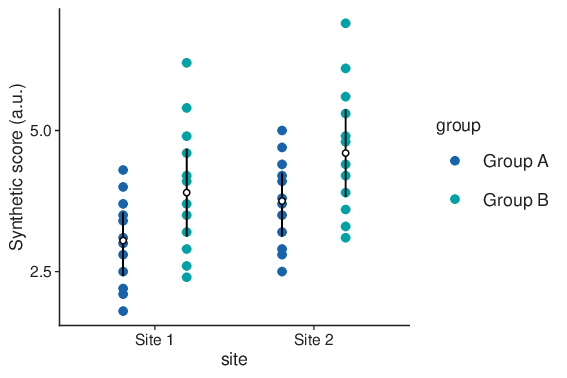 |
| box | 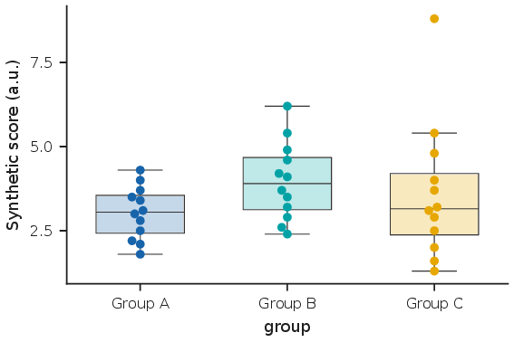 | 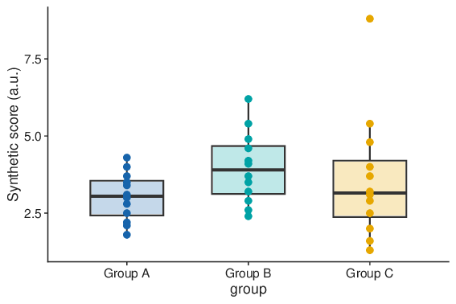 |
| grouped-box | 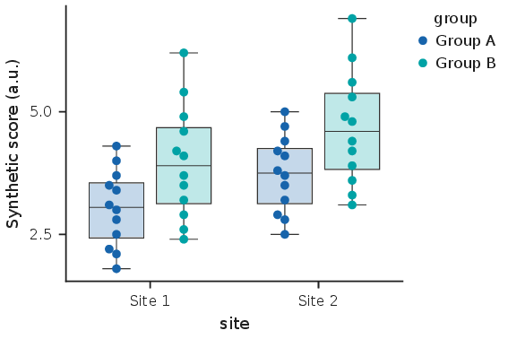 | 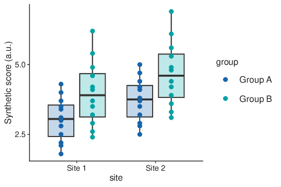 |
| violin | 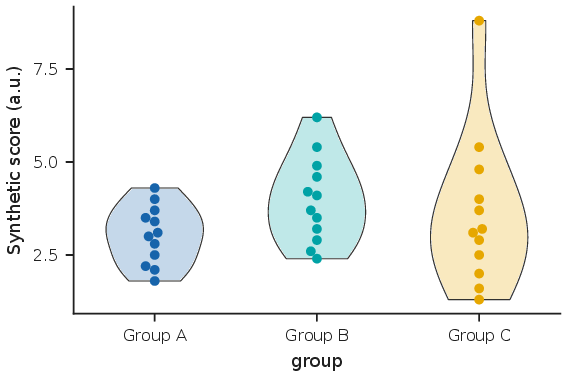 | 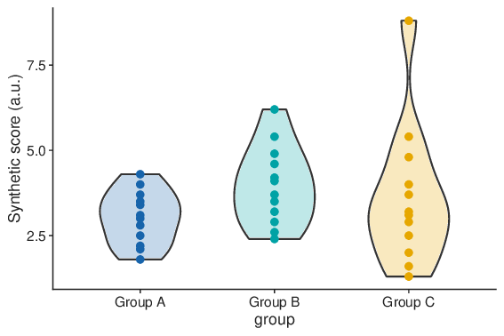 |
| facet | 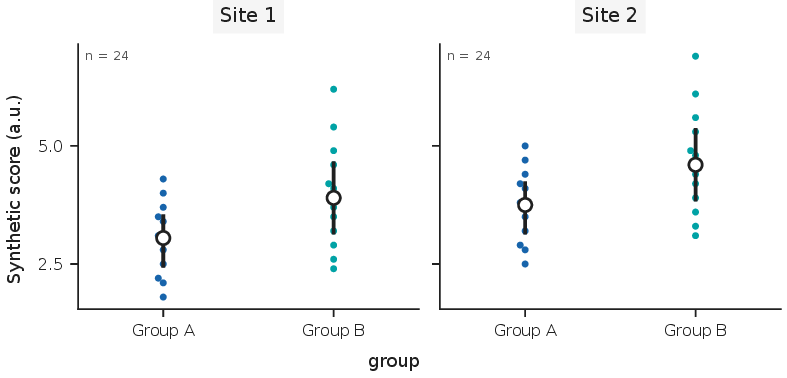 | 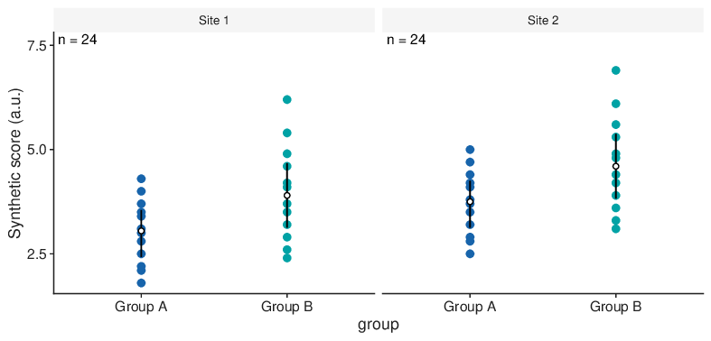 |
| dotplot | 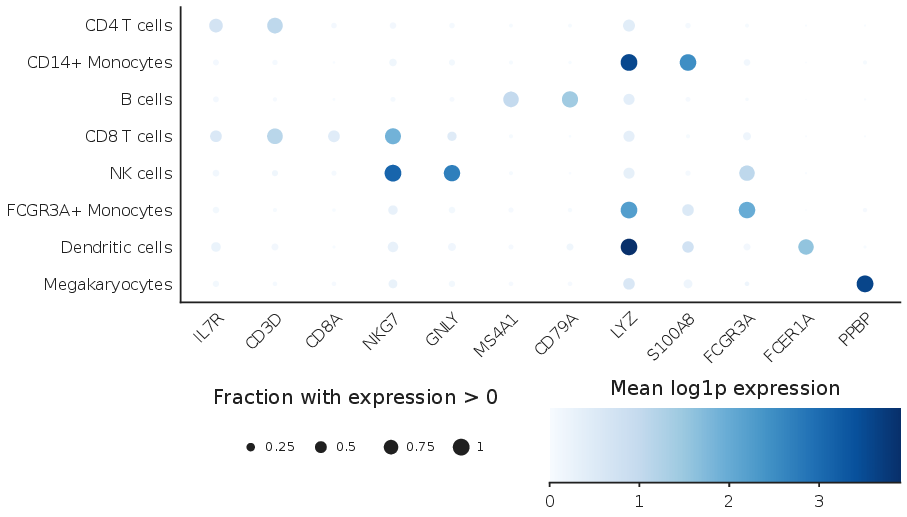 | 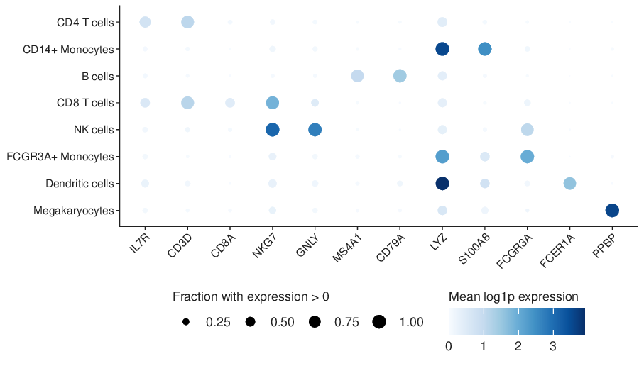 |
| heatmap | 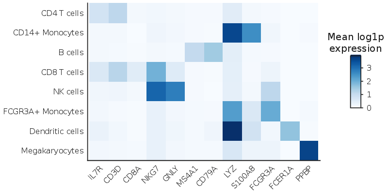 | 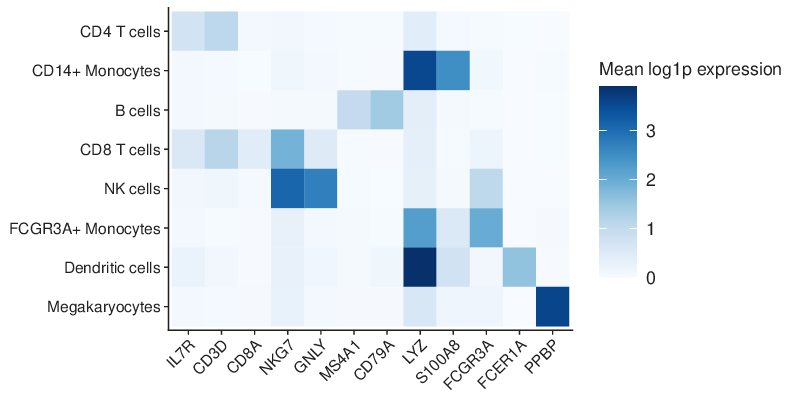 |
| forest | 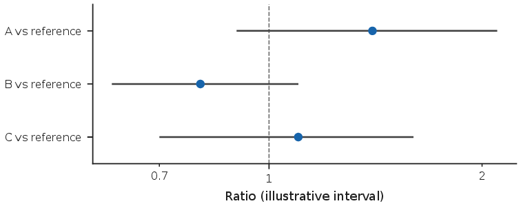 | 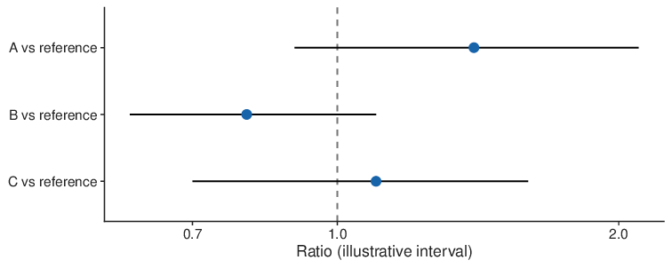 |
